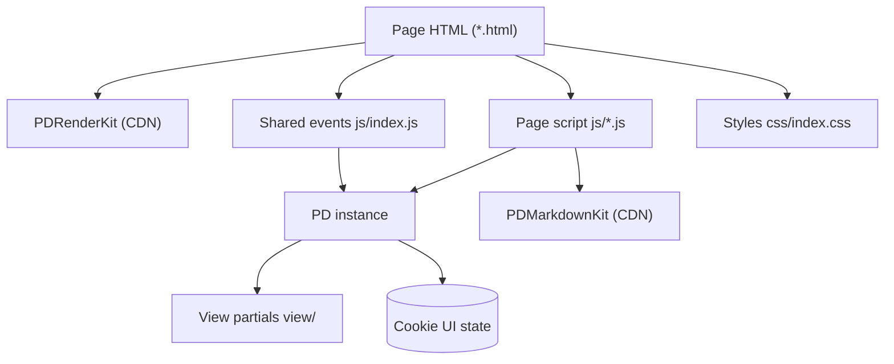

Last updated: 2026-10-25

> [!NOTE]
> This README was generated by [SKILL](https://github.com/agenvoy/skill-readme-generate), get the ZH version from [here](./doc/README.zh.md).

***

<strong>A ZERO-BUILD ADMIN DASHBOARD TEMPLATE POWERED BY PDRENDERKIT!</strong>

***

> A JavaScript admin dashboard template with PDRenderKit declarative views, Markdown and JSON editors, and an image file manager

## Table of Contents

- [Features](#features)
- [Architecture](#architecture)
- [License](#license)
- [Author](#author)

## Features

> `git clone https://github.com/pardnchiu/web-admin-20220917.git` · [Documentation](./doc/doc.md)

- **Zero-Build Static Pages** — Plain HTML, CSS, and JavaScript with every dependency loaded from the jsDelivr CDN, so any static host, including GitHub Pages, serves it as-is.
- **Declarative Page Assembly** — PDRenderKit data objects drive each page, shared top and side navigation load as view partials, and form and table fields render straight from data definitions.
- **Markdown Article Editor** — The PDMarkdownKit editor pairs with a live preview and a toolbar for headings, emphasis, lists, code, links, and photo-library images, with undo and redo.
- **Dual-Mode JSON Content Editing** — Page content switches between a field tree and a raw code view, and saving parses the JSON first and alerts on malformed input.
- **Image File Manager** — A folder-based library toggles between list and grid layouts, remembers the choice in a cookie, and offers preview, rename, move, and delete actions.

## Architecture

> [Full Architecture](./doc/architecture.md)

## License

This project is licensed under the [GPL-3.0 LICENSE](LICENSE).

## Author

Just [open an issue](https://github.com/pardnchiu/web-admin-20220917/issues/new) to share an idea.

***

©️ 2022 [邱敬幃 Pardn Chiu](https://www.linkedin.com/in/pardnchiu)
