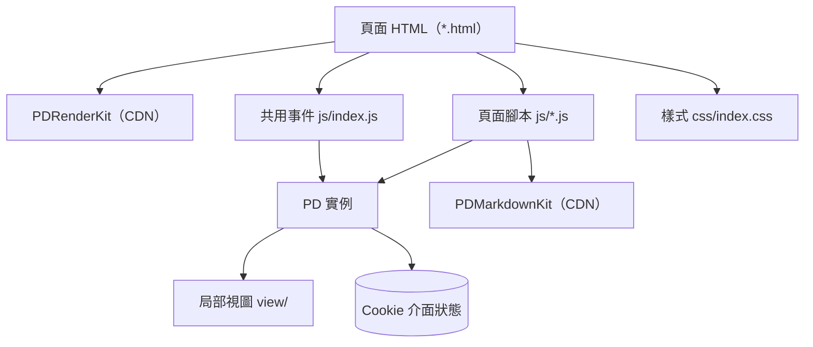

最後更新：2026-10-25

> [!NOTE]
> 此 README 由 [SKILL](https://github.com/agenvoy/skill-readme-generate) 生成，英文版請參閱 [這裡](../README.md)。

***

<strong>A ZERO-BUILD ADMIN DASHBOARD TEMPLATE POWERED BY PDRENDERKIT!</strong>

***

> JavaScript 管理後台範本，具備 PDRenderKit 宣告式畫面、Markdown 與 JSON 編輯器與圖片檔案管理

## 目錄

- [功能特點](#功能特點)
- [架構](#架構)
- [授權](#授權)
- [Author](#author)

## 功能特點

> `git clone https://github.com/pardnchiu/web-admin-20220917.git` · [完整文件](./doc.zh.md)

- **免建置的靜態頁面** — 純 HTML、CSS 與 JavaScript，相依套件全由 jsDelivr CDN 載入，任何靜態主機（含 GitHub Pages）即可直接部署。
- **宣告式頁面組裝** — 每頁以 PDRenderKit 的資料物件驅動，共用的頂部與左側導覽列以局部視圖（Partial）載入，表單與資料表欄位由資料定義自動渲染。
- **Markdown 文章編輯器** — 整合 PDMarkdownKit 編輯器與即時預覽，提供標題、粗體、列表、程式碼、連結與圖片庫插入工具列，並支援上一步／下一步。
- **JSON 內容雙模式編輯** — 同一份頁面內容可在樹狀欄位與原始碼兩種模式間切換，儲存時先解析 JSON 並在格式錯誤時提示。
- **圖片檔案管理** — 資料夾式檔案庫支援列表／格狀切換並以 Cookie 記住偏好，提供預覽、重新命名、搬移與刪除操作。

## 架構

> [完整架構](./architecture.zh.md)

## 授權

本專案採用 [GPL-3.0 LICENSE](../LICENSE)。

## Author

Just [open an issue](https://github.com/pardnchiu/web-admin-20220917/issues/new) to share an idea.

***

©️ 2022 [邱敬幃 Pardn Chiu](https://www.linkedin.com/in/pardnchiu)
