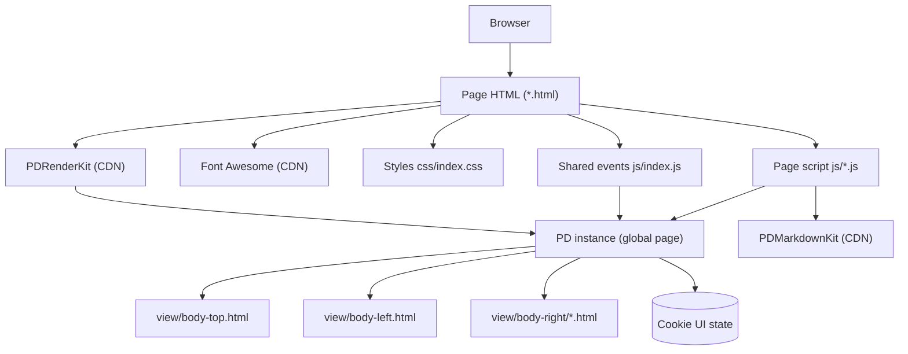
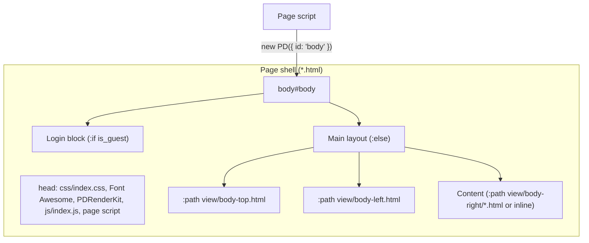
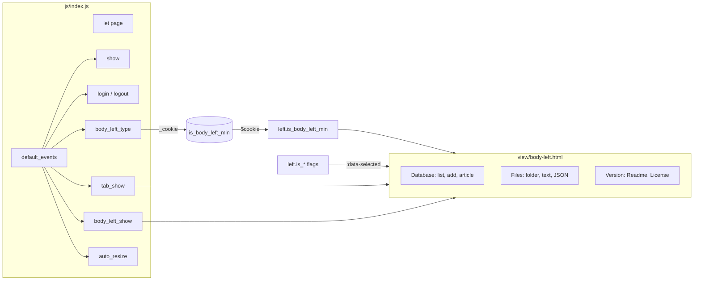
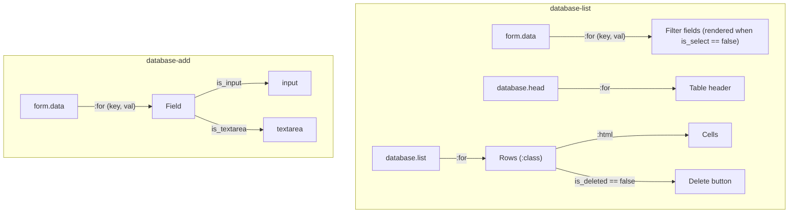
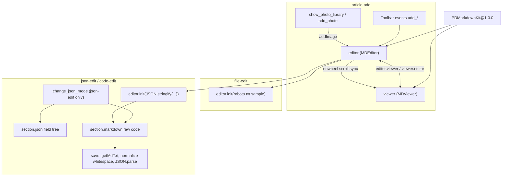
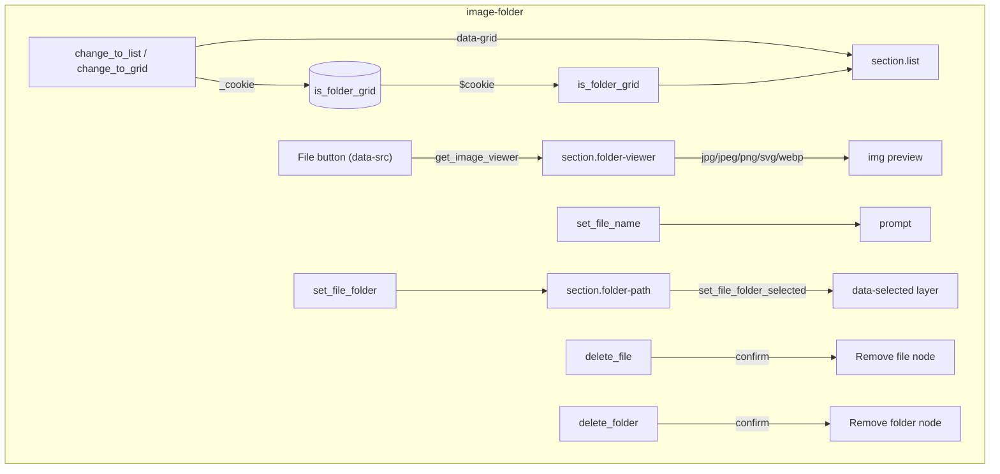
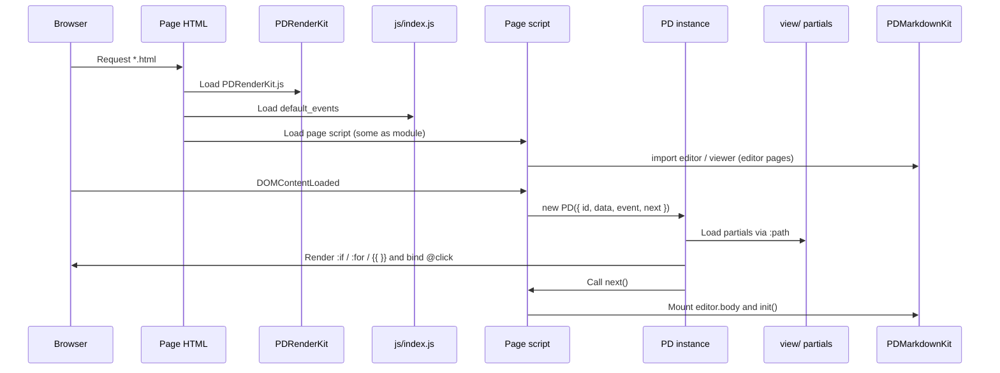
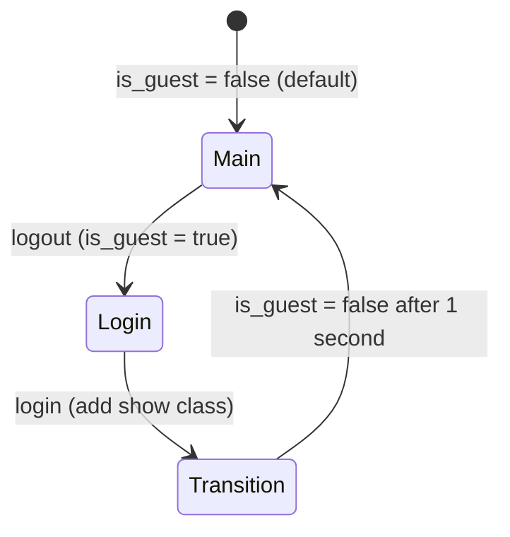
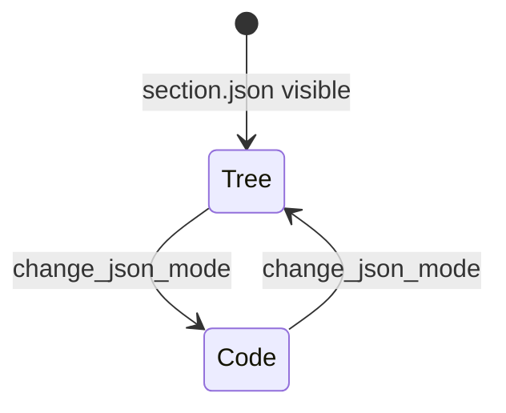
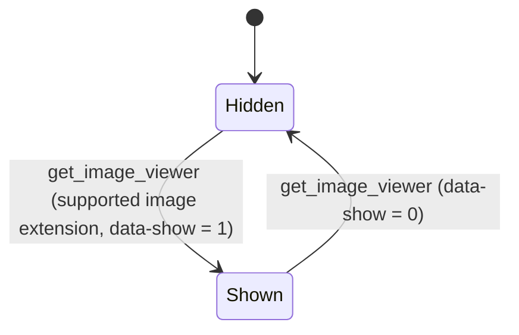

# web-admin-20220917 - Architecture

Last updated: 2026-10-25

> Back to [README](../README.md)

## Overview

## Module: Page Shell

Every `*.html` loads the same CDN assets plus `js/index.js`, switches between the login block and the main layout through `is_guest`, and assembles the main layout from three view partials.

| Page | Content source |
|------|----------------|
| `database-list`, `database-add`, `article-add`, `image-folder`, `file-edit` | `view/body-right/<page>.html` |
| `index`, `json-edit`, `code-edit` | Inline in the page HTML |

## Module: Shared Events and Navigation

`js/index.js` declares the global `page` and `default_events`; each page spreads them into its own `event`. The navigation marks the current page from the `left.*` flags.

## Module: Database Pages

`database-list` and `database-add` never touch the DOM directly; PD data renders every form field and table cell.

## Module: Editors

The article, text, and JSON pages import PDMarkdownKit as an ES module and mount the editor into `section.markdown` in the PD `next` callback.

## Module: File Folder

`image-folder` renders folders as `
` elements; events resolve files through `data-src` and drive the preview and move dialogs.

## Data Flow

## State Machine

### Login

### JSON Edit Mode (json-edit)

### Image Preview (image-folder)

***

©️ 2022 [邱敬幃 Pardn Chiu](https://www.linkedin.com/in/pardnchiu)
