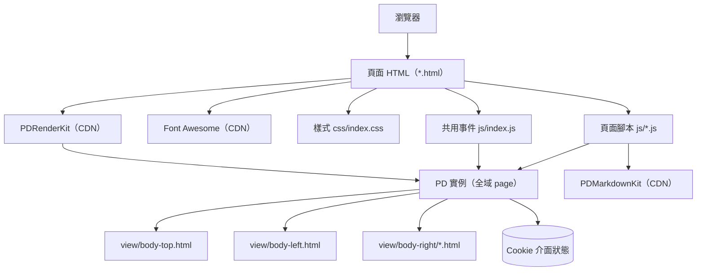
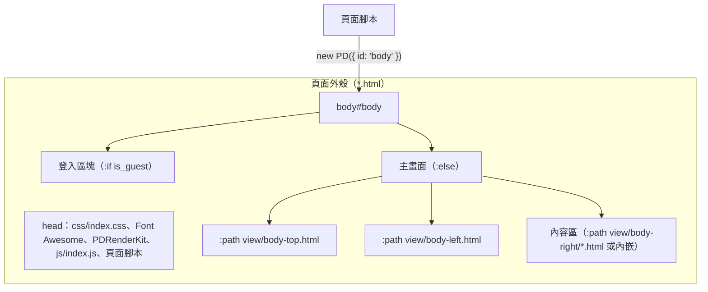
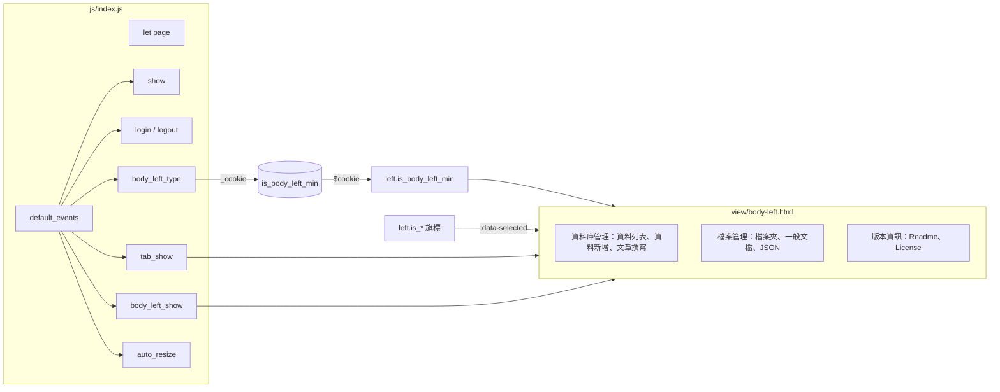
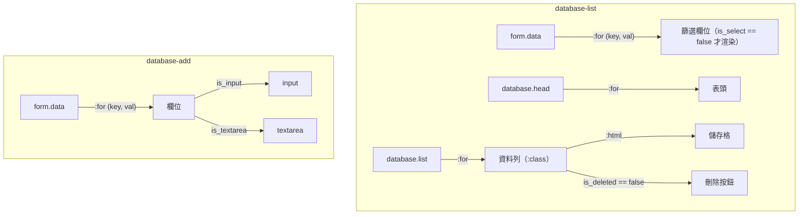
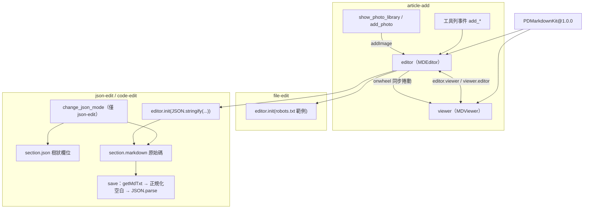
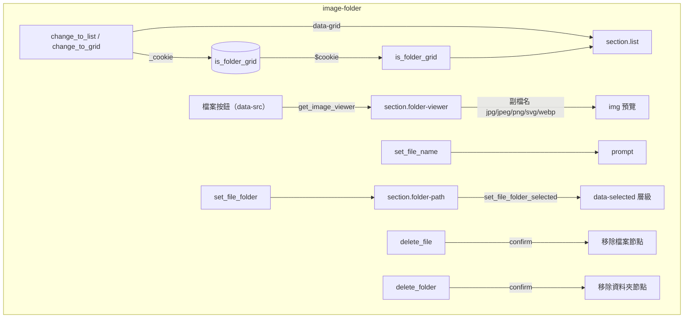
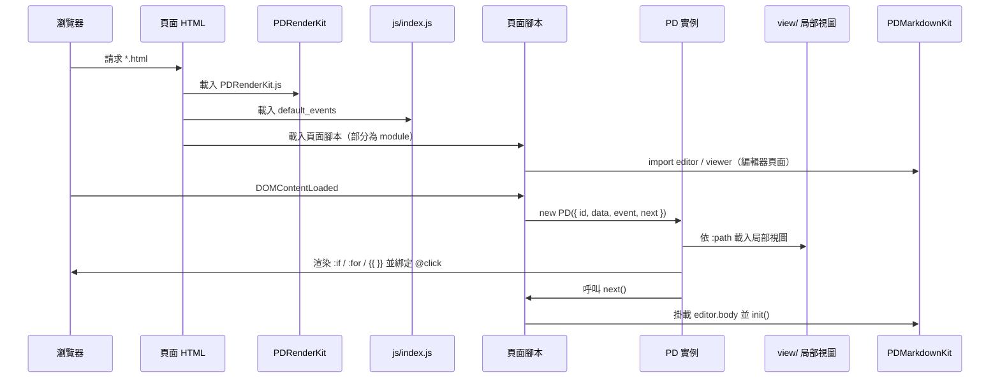
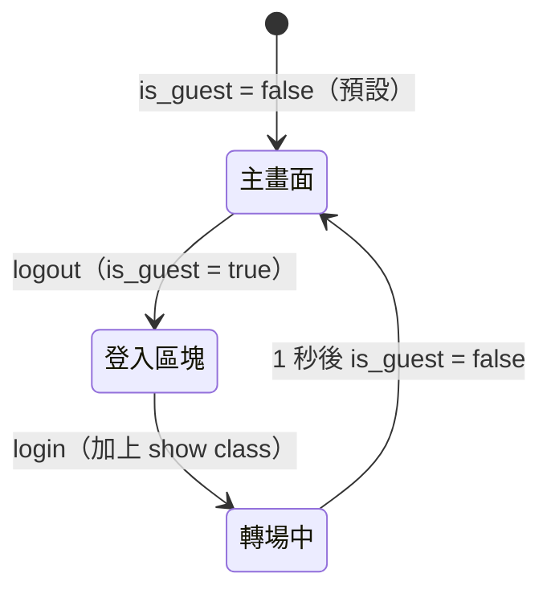
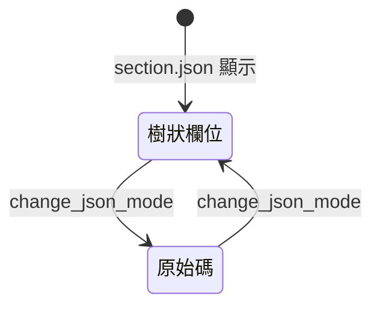
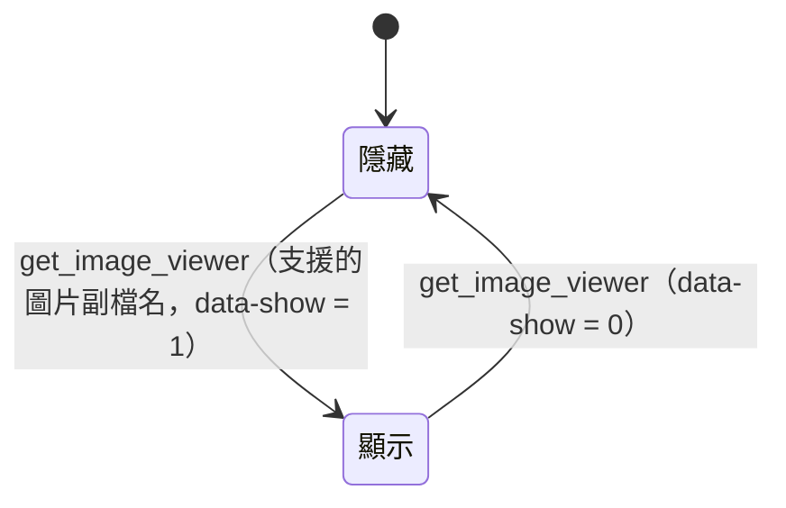

# web-admin-20220917 - 架構

最後更新：2026-10-25

> 返回 [README](./README.zh.md)

## 概覽

## Module: 頁面外殼

每個 `*.html` 載入相同的 CDN 資源與 `js/index.js`，以 `is_guest` 在登入區塊與主畫面間切換，主畫面由三個局部視圖組成。

| 頁面 | 內容區來源 |
|------|------------|
| `database-list`、`database-add`、`article-add`、`image-folder`、`file-edit` | `view/body-right/<頁面>.html` |
| `index`、`json-edit`、`code-edit` | 內嵌於頁面 HTML |

## Module: 共用事件與導覽

`js/index.js` 宣告全域 `page` 與 `default_events`，各頁以展開運算子併入自己的 `event`；導覽列依 `left.*` 旗標標示目前頁面。

## Module: 資料庫頁面

`database-list` 與 `database-add` 不寫 DOM，表單與資料表完全由 PD 資料渲染。

## Module: 編輯器

文章、文檔與 JSON 頁面以 ES Module 匯入 PDMarkdownKit，在 PD 的 `next` 回呼中把編輯器掛進 `section.markdown`。

## Module: 檔案夾

`image-folder` 以 `
` 呈現資料夾，事件透過 `data-src` 對應檔案並操作預覽與搬移對話框。

## 資料流

## 狀態機

### 登入

### JSON 編輯模式（json-edit）

### 圖片預覽（image-folder）

***

©️ 2022 [邱敬幃 Pardn Chiu](https://www.linkedin.com/in/pardnchiu)
